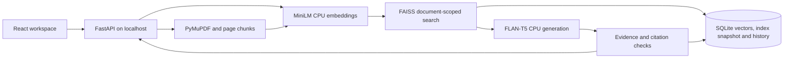
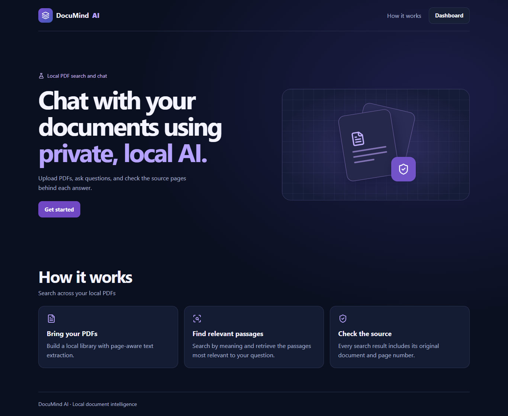
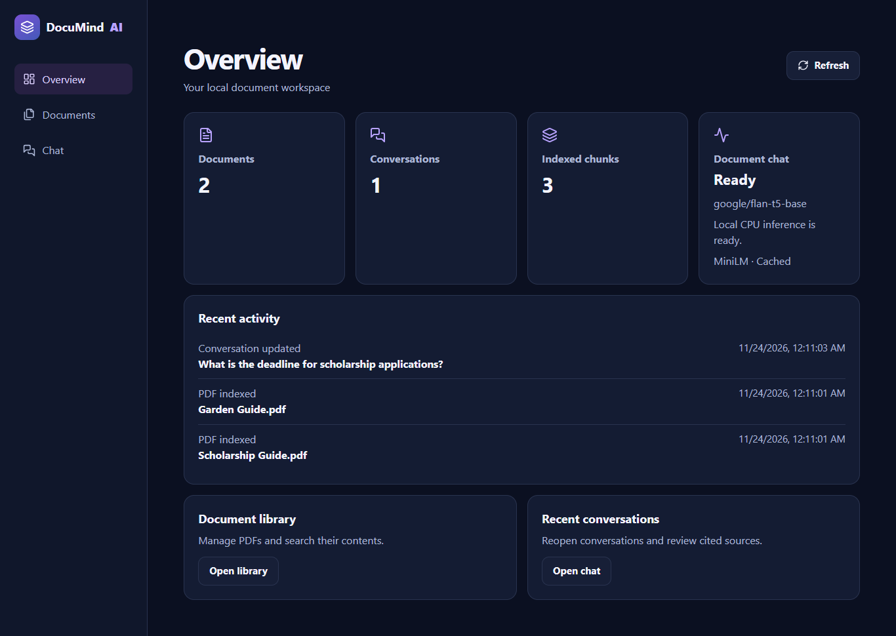
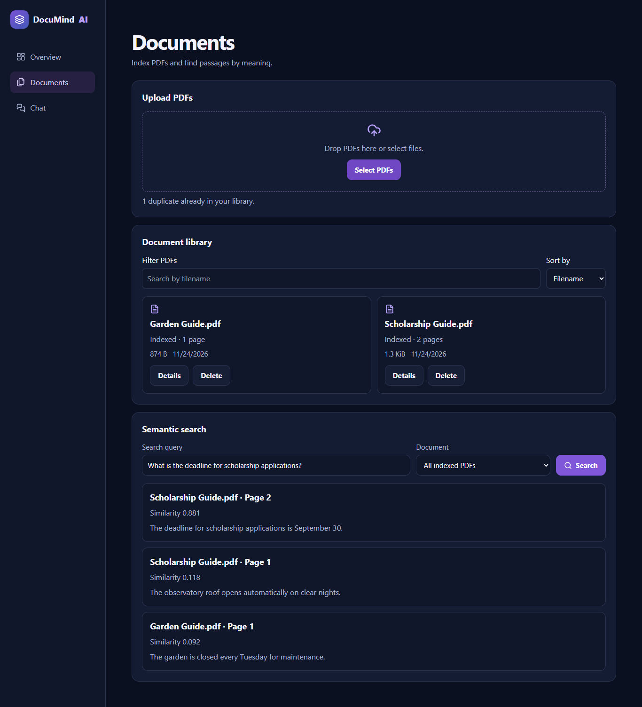
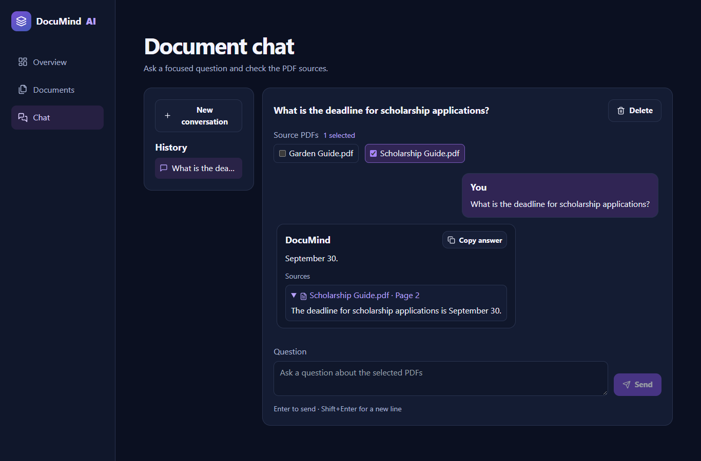

# DocuMind AI

**Chat with your documents using private, local AI.**

DocuMind AI indexes PDFs and answers focused questions about selected documents. It runs PDF extraction, embeddings, search, and generation in Python on the local CPU.

## Problem

Finding one answer in a long PDF can take several keyword searches, especially when the document uses different wording. DocuMind AI retrieves relevant passages by meaning and links answers to the original page so the reader can verify them. The PDF library and chat history stay on the machine.

## Features

- Responsive dashboard with live document, conversation, and indexed-chunk counts, recent activity, and local model status.
- Drag-and-drop PDF upload with batch progress and duplicate feedback. Filter and sort the library by filename, upload date, or size, and confirm before deletion.
- Semantic search with source passages and page references.
- Document chat with PDF selection, keyboard shortcuts, copyable answers, source excerpts, and persistent conversation history.
- Offline operation after the public model files are cached.

## Technology stack

| Layer | Technologies |
| --- | --- |
| Frontend | React, TypeScript, Vite, Tailwind CSS, React Router, Axios, React Markdown |
| API and persistence | Python, FastAPI, SQLAlchemy, SQLite |
| Ingestion and retrieval | PyMuPDF, Sentence Transformers, MiniLM, FAISS CPU |
| Generation | Hugging Face Transformers, PyTorch CPU, FLAN-T5 Base |
| Verification | Pytest, Vitest, React Testing Library, TypeScript, Chrome |

## Windows setup

Use 64-bit Python 3.11 or 3.12 and Node.js 20. From PowerShell:

```powershell
Set-Location "$([Environment]::GetFolderPath('DesktopDirectory'))\documind-ai"
python -m venv backend\.venv
.\backend\.venv\Scripts\python.exe -m pip install --index-url https://download.pytorch.org/whl/cpu 'torch==2.9.1+cpu'
.\backend\.venv\Scripts\python.exe -m pip install -r backend\requirements.txt
Set-Location frontend
npm.cmd ci
```

Copy either component's `.env.example` to `.env` in that component to override defaults.

### Download the models

Run these commands from `backend` with internet access and offline mode disabled:

```powershell
Set-Location "$([Environment]::GetFolderPath('DesktopDirectory'))\documind-ai\backend"
$env:DOCUMIND_OFFLINE = 'false'
$env:HF_HUB_DOWNLOAD_TIMEOUT = '120'
.\.venv\Scripts\python.exe -c "from app.core.config import Settings; from app.rag.embeddings import cache_model; print(cache_model(Settings()))"
.\.venv\Scripts\python.exe -m app.rag.llm
```

MiniLM and FLAN-T5 Base are public, ungated Hugging Face models. FLAN-T5 Base downloads about 1 GB of weights. The default cache is `backend/data/models`. The optional `DOCUMIND_MODEL_CACHE_DIR` can point to a different cache. Set `DOCUMIND_LLM_MODEL` to configure a compatible public seq2seq model or a local directory containing fast tokenizer assets and safetensors.

### Run locally and offline

Backend terminal:

```powershell
Set-Location "$([Environment]::GetFolderPath('DesktopDirectory'))\documind-ai\backend"
$env:DOCUMIND_OFFLINE = 'true'
.\.venv\Scripts\python.exe -m uvicorn app.main:app --host 127.0.0.1 --port 8000
```

Frontend terminal:

```powershell
Set-Location "$([Environment]::GetFolderPath('DesktopDirectory'))\documind-ai\frontend"
npm.cmd run dev
```

Open [DocuMind AI](http://127.0.0.1:5173/), then use **Documents** to upload a text PDF. Open **Chat**, select one or more PDFs, and ask a focused question such as “When is the scholarship application deadline?” or “What documents are required?” Press **Enter** to send or **Shift+Enter** for a new line. Expand a source card to review the cited excerpt. Reopen a saved conversation from **History**. Write self-contained questions because each turn retrieves evidence independently.

## How document chat works

MiniLM embeds your question and FAISS retrieves top-ranked chunks from the selected PDFs. The backend filters low-similarity passages, builds a prompt within FLAN-T5's token budget, and sends it to a single CPU model worker. FLAN-T5 is prompted to produce a short extractive answer. The backend checks the answer against the actual prompt excerpts, allowing equivalent date formats and basic answer framing. Citations are constructed from retrieved document metadata. When support is insufficient, the app reports that explicitly. SQLite stores the question, answer, and cited excerpts with the conversation.



See [architecture](docs/architecture.md) and the [local API docs](http://127.0.0.1:8000/docs).

## Screenshots

Captured in Chrome with synthetic sample PDFs.

**Landing page**



**Dashboard**



**Document library**



**AI chat and source citations**



See the [interview demo](docs/demo-script.md) and [resume and interview notes](docs/resume-points.md).

## Verification

```powershell
Set-Location "$([Environment]::GetFolderPath('DesktopDirectory'))\documind-ai\backend"
.\.venv\Scripts\python.exe -m pytest -q
$env:DOCUMIND_TEST_REAL_MODEL = '1'
$env:DOCUMIND_TEST_REAL_CHAT = '1'
$env:DOCUMIND_TEST_RAG_EVAL = '1'
$env:HF_HUB_OFFLINE = '1'
.\.venv\Scripts\python.exe -m pytest -q -s
Remove-Item Env:\DOCUMIND_TEST_REAL_MODEL,Env:\DOCUMIND_TEST_REAL_CHAT,Env:\DOCUMIND_TEST_RAG_EVAL,Env:\HF_HUB_OFFLINE
Set-Location ..\frontend
npm.cmd test
npm.cmd exec -- tsc --noEmit
npm.cmd run build
```

The opt-in tests use the cached CPU models, index generated PDFs, verify semantic search and real answers with page citations, and reopen SQLite state after application restart. The [evaluation fixture](backend/tests/fixtures/rag_evaluation.json) generates three PDFs with six pages. The evaluator reports Recall@2 for answerable questions, factual answer accuracy, expected page accuracy for emitted citations, abstention, and elapsed HTTP request time including the cold model load.

### Offline evaluation on the Windows CPU

| Measure | Observed |
| --- | ---: |
| Retrieval Recall@2 | 100% (4 factual questions) |
| Factual answer accuracy | 4/4 |
| Expected page accuracy for emitted citations | 4/4 |
| Abstention on unsupported questions | 1/1 |
| HTTP request latency (median, range) | 730 ms, 47–1,663 ms |

The first request loaded the model. This small synthetic fixture measures the tested examples.

## Troubleshooting and limits

- **Model unavailable** · Run both model download commands online, check the cache path, then restart with offline mode enabled. Dashboard status reports cache availability and initialization errors without loading the weights.
- **Model busy or timed out** · Send one question at a time. The first question also loads the model. Adjust `DOCUMIND_LLM_TIMEOUT_SECONDS` if cold starts are slower on your machine. `DOCUMIND_LLM_MAX_NEW_TOKENS`, `DOCUMIND_LLM_CPU_THREADS`, `DOCUMIND_SEARCH_TOP_K`, and `DOCUMIND_CHAT_MIN_SIMILARITY` control CPU work and retrieval.
- **Connection refused** · Start Uvicorn and Vite in separate terminals and check the printed URLs. The frontend expects port 5173 and the backend expects port 8000 by default. Restart the backend after upgrading to make the new API available to the frontend.
- **No extractable text** · Run OCR on image-only PDFs before uploading.
- **Insufficient evidence** · Check the selected PDFs, ask one factual question at a time, or use semantic search to find the relevant source. The evidence check accepts only narrow equivalences, so it can reject valid paraphrases. Review the cited passage for relevance and context.

### Local security

Authentication is not implemented. Keep the backend and frontend on loopback with one backend worker per data directory. The backend accepts local hostnames and rejects browser write requests from unapproved origins. **Do not expose this application publicly** without adding authentication, authorization, and deployment security controls. Uploaded files, history, the model cache, and the SQLite database are local runtime data and are excluded from Git.

FLAN-T5 Base is intended here for short factual answers with a bounded context and output. Each question retrieves evidence independently. Historical chat citations retain excerpt snapshots even if the source PDF is later deleted.

## Future improvements

- Evaluate hybrid retrieval on a larger, more varied set of PDFs and questions.
- Add OCR for image-only pages and improve extraction from dense tables.
- Explore evidence checks for multi-sentence answers and conversational follow-ups.
- Add authentication and per-user data isolation before considering a shared deployment.
