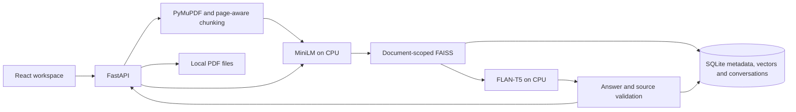

# Architecture

## Request boundary

React and TypeScript provide the landing page, dashboard, document library, and chat. The frontend uses Axios to call FastAPI. Route handlers validate requests with Pydantic and delegate to the ingestion and chat services. Dashboard counts and recent activity come from SQLite. Both servers bind to IPv4 loopback in the documented setup. FastAPI accepts local hostnames and rejects browser writes from unapproved origins. Authentication is outside this local MVP.

## Document ingestion and search

FastAPI checks the uploaded file size before reading the payload. PyMuPDF validates the PDF and extracts page text. The chunker keeps overlapping windows within one page, with source text and page number attached. MiniLM embeds the normalized text into 384-dimensional unit vectors. FAISS inner product therefore ranks cosine similarity. SHA-256 detects duplicate files.

SQLite commits chunk vectors and a serialized FAISS snapshot in one transaction. An upload flushes the PDF before committing and removes it if the transaction fails. Deletion removes metadata and vectors transactionally before removing the PDF. Startup removes orphan app-owned files. Document-scoped search builds a FAISS index from only the selected SQLite vectors and returns ranked metadata. Scores are inner products on normalized embeddings.

## Local generation and history

Chat validates indexed document IDs, narrows retrieval by similarity, and constructs a token-bounded prompt with quoted untrusted excerpts. A single worker loads the cached FLAN-T5 tokenizer and model lazily. Generation is greedy on the CPU with a token cap and a cooperative inference deadline. The caller receives a timeout if that deadline is reached, and a running model load or decoding step retains the worker until it finishes or stops.

The app accepts a short output when it matches text in at least one prompt excerpt after bounded normalization for casing, spacing, equivalent date forms, and simple answer framing. It builds citations from those excerpts' stored document ID, filename, page, and chunk ID. This verifies provenance for the displayed quote. Ranking and relevance still depend on the model and retrieved text.

Both messages are persisted in one SQLite transaction. Only the selected document IDs and cited excerpts accompany the conversation. Deleting a conversation cascades to its messages. Historical citations remain as snapshots when an indexed document is later deleted. Existing Phase 1 conversation rows and Phase 2 index data use the same database schema.

Model status inspects the local cache and worker state. Model downloads use the Hugging Face Hub only during setup, while inference opens local weights and does not call an external inference endpoint.
